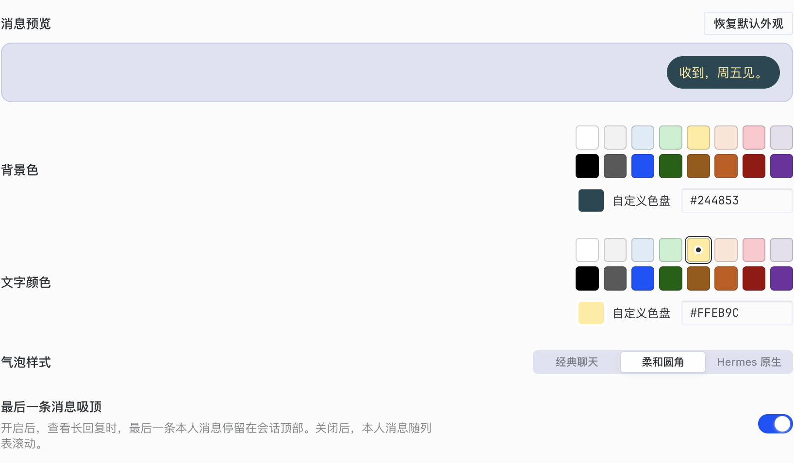
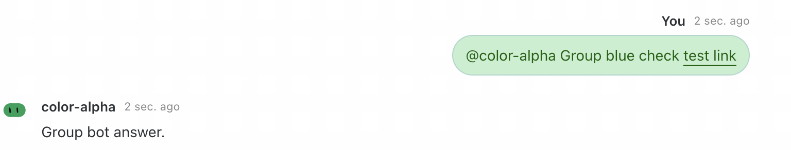

# Own Messages · Hermes Blue

**本人消息 · Hermes 蓝** for Hermes Desktop. Give messages you send a recognizable background, text colour and shape in the existing conversation. Other participants keep their usual appearance.

## Controls

Open **Settings → Plugins → 本人消息 · Hermes 蓝**. Choose the background and text colours independently. Each offers sixteen preset swatches, a colour picker and six-digit HEX entry. Try light green (`#C6EFCE`) with dark green (`#006100`). The preview shows changes as you make them.

The default is a right-aligned classic bubble in Hermes blue (`#0053FD`) with white text. Choose classic, rounded or native bubble shape. In direct chats the last prompt scrolls with the conversation by default. **最后一条消息吸顶** enables pinning while reading a long reply. Resetting the appearance preserves the pinning choice.

## 中文说明

在 **设置 → 插件 → 本人消息 · Hermes 蓝** 中，分别选择背景色和文字颜色。每项均有 16 个预设色，也可以用色盘或输入 HEX。单聊和群聊里，新旧本人消息都使用所选外观。群聊按作者身份判断，机器人、定时消息和同名成员保留原有样式。

「最后一条消息吸顶」用于单聊，默认关闭。设置在重启后保留。「恢复默认外观」恢复蓝底白字和经典聊天气泡。

## Compatibility and catalog status

This is the local working version, packaged as `0.1.0-dev.1` for review. It was exercised on the macOS Apple Silicon desktop application. Platform coverage for other systems is unverified. Official catalog admission is pending a supported way to apply appearance to the sender's own messages and to control last-prompt pinning. [Request for a public message appearance hook](https://github.com/NousResearch/hermes-agent/issues/147146#issuecomment-6979343193) · [Upstream proposal for the pinning preference](https://github.com/NousResearch/hermes-agent/pull/126514).

## Data and runtime behaviour

The plugin runs in the desktop renderer. It stores colours, shape and the pinning preference locally. When the pinning preference is unset, this build reads one boolean preference left by an earlier local scroll plugin. It observes rendered message rows, inspects the rendered group author metadata and applies local styles. Those accesses are the current catalog validation blocker. It sends no network requests, runs no shell commands, launches no background processes and collects no telemetry or credentials. The message pictures in this repository use an isolated test profile with synthetic text.
